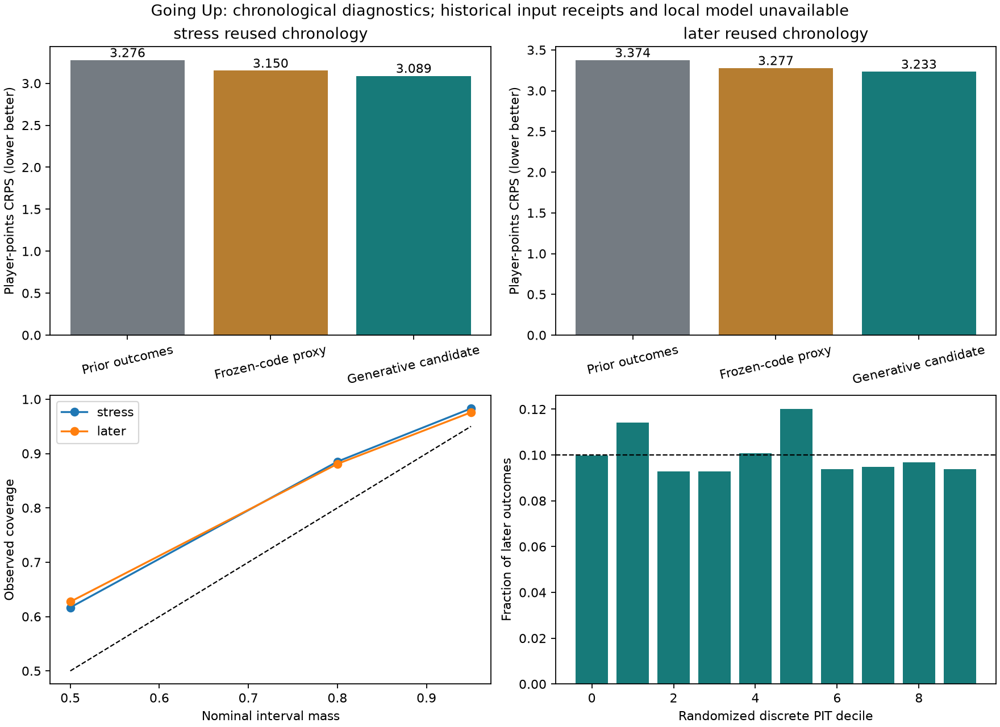

# Going Up: independent NBA player-points study

[Download the full study](GOING_UP_START_HERE.md) · [Claude handoff](GOING_UP_HANDOFF.md)

One isolated generative candidate was evaluated using basketball data only. Existing NBA models and all 56 protected original files remain unchanged. This report concerns retrospective research; it does not authorize model replacement.

## 1. Does it outperform the existing NBA model?

That question is unresolved. The local Windows application and its immutable player-points forecasts were unavailable. The accessible KOTC code already generates points through minutes, attempts and conversion. Its saved real-data study used postgame fields, not original pregame forecasts.

The new study compares **A**, a prior-outcomes empirical distribution; **B**, unchanged KOTC code reconstructed on the same earlier roster proxy with an unknown-experience adapter; and **C**, one new generative candidate. B is an auxiliary reference, not the unseen production model.

C uses a participation hurdle and empirical positive minutes constrained to team time; jointly sampled earlier game/possession-proxy/FGA/FTA templates; integer player opportunity allocation; and partially pooled Gamma/Beta rates and conversion. These are structural hypotheses, not identified causal effects. No sportsbook information entered development or evaluation.

## 2. How large and uncertain is the difference?

Development selected a 90-day half-life and five prior pseudo-games from four configurations. The season decay was fixed at .65. Parameters were not changed after assessment began. Each prediction used its season-to-date and three preceding seasons.

| Historical period | Games / player-games | A CRPS | B reconstruction CRPS | C CRPS |
| --- | ---: | ---: | ---: | ---: |
| January–February 2026 | 53 / 1,289 | 3.2755 | 3.1500 | 3.0885 |
| March 1–April 12, 2026 | 42 / 1,033 | 3.3741 | 3.2770 | 3.2328 |

C-minus-reference CRPS, with approximate paired game/player-cluster 95% intervals:

- Earlier versus A: **−.1870**, interval **[−.3179, −.0628]**, a 5.71% reduction.
- Later versus A: **−.1413**, interval **[−.3047, +.0332]**, a 4.19% reduction.
- Earlier versus B reconstruction: **−.0614**, interval **[−.0969, −.0276]**, a 1.95% reduction.
- Later versus B reconstruction: **−.0442**, interval **[−.0879, −.0044]**, a 1.35% reduction.

The later baseline interval includes no improvement. Both B-reference gains fall below the registered .10-point practical threshold; they also fall below 2%. Later MAE was 4.7498 for C, 4.9453 for A and 4.7468 for B. A small CRPS gain does not establish universal superiority.

There were 100 and 84 unknown player outcomes in the respective prior-roster fields. They were not turned into zeros. Pointwise missing-outcome bounds retain a negative average CRPS difference but allow gains to shrink greatly: later C-minus-A bounds are [−.2249, −.0077]. These bounds do not verify roster membership or remove sampling uncertainty.

## 3. Which scoring components explain errors?

Development-only component checks show a meaningful minutes/role problem but do not identify additive causal error shares. On the first 12 eligible development games, C's minutes CRPS was 3.693 versus B's 4.110. Points and minutes residuals correlated about .64. C's nominal 80% minute intervals covered 97.9%, indicating broad uncertainty in this subset; B's covered 79.3% but its positive-minute model assigned zero nonparticipation probability despite observed DNPs.

Only one game / 26 player-games had complete enough proxy coverage for coherent recorded-minute oracles. There, recorded-minute conditioning reduced C's points CRPS by .869. A nested recorded-minute-and-individual-attempt oracle reduced it by 1.851. These use outcome information and are not attainable forecast gains. Recorded team attempts alone did not improve that small cohort. Fixed latent conversion and simplified opportunity uncertainty had little effect. Their differences cannot be added as a variance decomposition.

Two development diagnostic defects were corrected before assessment, with original receipts retained and actual C samples proven unchanged: align identical player sets by ID under a longer result embargo, and enforce recorded-minute support in the individual-attempt oracle.

## 4. What uncertainty is reducible?

Genuine pregame roster, injury, rotation and role information may reduce input uncertainty. No historical injury inputs were used. Unknown experience was never labeled rookie or second-year. Real shot conversion, pace and rotation choices remain stochastic, but this study cannot estimate an irreducible-error floor.

The shared template mechanism preserves observed game totals but is not an opponent-specific possession model. Three-prior-season player evidence relies on reconciled box histories; event-reconciled team templates have narrower ending-year-2026 support. Missing native JSON, inferred lineup seeds, archive revisions and finite empirical tails remain limitations.

## 5. Does it generalize across time and calibrate better?

CRPS direction persisted across the two chronological periods, but evidence weakened later. All historical archives had already been inspected. These are rolling-origin replays under an assumed 36-hour result lag, not untouched historical forecasts. Strict contemporaneous-source enforcement yielded **zero** eligible historical forecasts.

Later C coverage for the nominal 80% points interval was 88.1%; its discrete PMF assigned those intervals 87.5% mass. Discrete counts and zero mass make direct comparison to 80% alone misleading. The registered coverage gate remains unchanged; it is conservative for these distributions. A assigned 88.7% interval mass and covered 89.1%; B assigned 86.2% and covered 83.2%. Central coverage does not demonstrate better calibration against A.

C predicted 30+ points on 2.05% of later player-games versus 2.71% observed; its 30+ Brier score was slightly worse than A's. Only five 40+ outcomes occurred across both assessments. Rare-tail calibration is not established. First-game-per-Eastern-date sampling also limits generalization to the entire NBA.

## 6. Which falsification checks survived or failed?

All extremes stayed in primary scoring. The second fixed simulation seed preserved the broad result; aggregate C CRPS changed by −.0016 and −.0007. Week/player-cluster sensitivity also left the later C-versus-A interval crossing zero. Reducing pooling improved development CRPS slightly, so no claim that every complexity is necessary survives; the selected candidate was nevertheless retained unchanged. Stronger pooling worsened development scores.

The 72-hour result embargo had only 26 matched development observations after warmup/field checks and worsened CRPS by .091 there; this is insufficient robustness evidence. Strict historical availability failed entirely because actual contemporaneous records were missing. Finite simulation/empirical support produced zero probabilities at some observed counts, so a reliable full log-score comparison is unavailable; no arbitrary floor rescued it.

## 7. What independently verifies the work?

An independent parser reconciled points and 2P/3P/FT attempts/makes for all 1,230 regular-season raw NBA games. Of these, 1,182 supplied accepted mapped, minute-checked templates. The original event/stint audit and 48 original tests reproduced; 14 new tests passed. Independently recalculating 13,281 development/assessment forecast scores through a different CRPS identity agreed within 2.2e-14.

An old simulator reproducibility defect was verified: equal-tipoff games were ordered from a set without a secondary key. Restoring the saved ordering reproduced its retained scores. Old code remained unchanged.

Sources, original bytes' hashes, safe derived inputs, source/known-time limitations, forecasts, outcomes, exclusions, both seeds, conditional Monte Carlo errors, paired intervals, code versions and locks are delivered. Registration/locks are local process receipts, not independent public timestamp attestations. Passing checks establish arithmetic and preservation, not predictive validity.

## 8. Is further forward testing justified?

The candidate is suitable for a bounded **research-only** forward comparison if genuine pre-tipoff input receipts and market-free original local-model distributions can be obtained. It is not justified as a replacement. Before any future outcomes, the confirmation reservation was transparently extended to November 1, 2026–February 28, 2027 so the unchanged sample minimum could potentially be met. No future forecasts, collection adapter, jobs or deployments were created.

Inconclusive: insufficient reliable evidence
