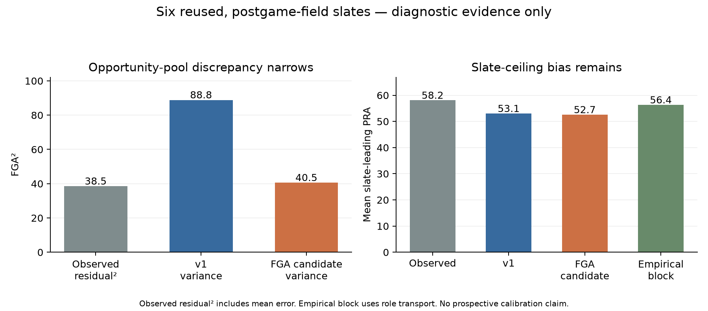

# Distribution experiment: a measured discrepancy, no supported replacement

**Overall predictive verdict: inconclusive. Replacement of v1: unsupported.** A single FGA-pool candidate corrects a measured opportunity-variance discrepancy, but does not establish better PRA distributions or leader probabilities. V1 remains unchanged. No interface, market, ownership model, live recommendation, scheduler or publication was added.

The [assumption audit](../../../docs/KING_COURT_DISTRIBUTION_AUDIT.md), [plan](PLAN.md), [actual-time registration](registration.json) and [code lock](code-lock.json) precede the model comparison. The [measured summary](comparison-summary.json) retains all variants, both assessment seeds, paired intervals, subgroup coverage and source/code hashes. Full local observations are `.cache/king-court-deepening/registered-comparison.json`.



## What was tested and why

V1 samples shared game pace, then independent Poisson team FGA pools. Its conditional FGA variance therefore equals its conditional mean, about 89 attempts² in this sample. That extra variation was an assumption, not an estimated basketball property.

The development-only box check found residual variances of 39–41. Because the box possession proxy contains FGA algebraically, this alone was insufficient evidence. A corroborating check on **367 development games with reconciled event statistics** used the archive's counted possession groups: residual variances were 40.8–46.5 versus Poisson-implied 88.9–89.4. These are producer-derived possessions from the same NBA feed, not an independent vendor or unqualified ground truth.

This component was selected because it can be measured without inventing historical availability. It was not assumed to explain the largest total PRA error. The minute/availability assumptions remain substantial and separate.

**The only model change:** recency-weighted paired empirical FGA residual ratios replace the independent Poisson FGA pool. Residuals are centered using earlier eligible games, sampled jointly for both teams, and stochastically rounded to nonnegative integers. Conditional means remain unchanged absent clipping. FTA, player allocation, minutes, shooting, rebounds, assists and overtime are unmodified. The finite empirical residual support does not establish unobserved extreme-tail behavior.

The candidate lives in `scripts/king_court_diagnostics/`, outside the original package. Tests strip only the declared instrumentation/pool hooks and require the remaining simulator AST to equal v1. With the repair disabled, every original points/rebounds/assists/minutes/PRA sample matches exactly for the same seed. All preserved v1, rule/protocol and NBA-winner source hashes still match the registration. The FTA override is an observed-pool diagnostic only, never part of the repair.

## Evidence quality and available raw material

The [source-evidence receipt](source-evidence.json) records URLs, retrieval times, hashes and limitations for parsed NBA action rows, substitution descriptions, lineup snapshots, exact-minute NBA boxes, possession groups, explicit NBA/ESPN game/player crosswalks and ESPN play-by-play. Native original vendor JSON and independently observed lineup seeds remain unavailable. The published lineup snapshots are inferred by the producer; they are not an independent feed.

Across **1,230 regular-season games**:

- Credited event shooting/PRA statistics agree with NBA boxes in **1,186** games.
- Period-start lineup seeds plus raw substitution sequences reconstruct exact NBA box minutes within two seconds in **1,097** games.
- Both checks pass in **1,095** games.
- Canonical ESPN boxes agree with mapped NBA boxes in **1,138** of the matched accepted games. Incomplete mappings and disagreements remain failures.

The archive splits related steals/blocks into separate records sharing an action number. The auditor uses record order to preserve these related events rather than falsely deduplicating them. Ambiguous assist names and substitutions are not guessed. Reconciliation failures remain in the audit.

Among missed free throws, **6,327** were nonfinal or technical attempts, **6,175** were ordinary final attempts that could be reboundable, and **42** had ambiguous/retained-possession sequence evidence. “Potentially reboundable” does not mean an observed rebound chance. This documents a separate proxy weakness; it was deliberately not repaired in this experiment. Credited assists never become inferred potential assists.

## Chronology, field and experience limits

Eight retrospective development Tuesdays were registered; **seven complete slates / 34 games** were usable. December 16 had no completed regular-season games. The eight-member recency/prior grid was compared on those earlier dates only. The diagnostic choice was season decay **.65**, within-season half-life **90 days**, and **5** prior games. It is not a valid v1 prospective-selection receipt: the data is reused and there are fewer than eight eligible development slates. The same settings were used for every assessment variant without retuning. A development-slate bootstrap chose this grid point in 97% of resamples; that is conditional selection stability, not a 97% probability the parameters are correct.

Twelve later calendar Tuesdays were registered for reused retrospective assessment. Only **six complete slates / 40 games / 1,046 player-games** passed the unchanged complete-field gate. January 13, January 20, February 3, February 24 and March 3 each had an unreconciled game; February 17 had no completed regular-season games. Entire slates were excluded. No surviving shortlist was called a complete competition.

Those **six slates are the uncertainty units**, not 1,046 independent trials. Four dates / 757 player-games also pass event, stint and canonical/NBA box agreement for every game; that stricter subset gives no supported improvement either.

Every historical prediction uses only earlier observations after the same 36-hour lag, within its season-to-date plus three preceding seasons. The extra 2023 support archive was needed for historical ending-year 2026 targets; no out-of-window observations train a target.

**These are posterior-predictive diagnostics conditioned on recorded postgame fields. They are not pregame forecasts.** Nobody's historical injury status or pregame availability was inferred from participation. Unknown experience uses an explicitly labeled common position prior in both simulator comparisons. No verified debut metadata was supplied: rookie, second-year and established strata have **zero verified observations**; all 1,046 are reported unknown. The existing verified-experience prior implementations remain intact, but this experiment cannot validate them. Prior ESS and season contributions are retained per player, and FGA-pool effective support ranges from approximately 2,836 to 3,327 earlier games.

## Paired results

Primary assessment seed, 5,000 simulations per slate. Lower loss is better; coverage targets 80%.

| Diagnostic | Original v1 engine | FGA candidate |
| --- | ---: | ---: |
| PRA CRPS | 4.5386 | 4.5406 |
| PRA MAE, equal-slate average | 6.5000 | 6.5047 |
| 80% interval coverage | 76.29% | 75.85% |
| Above predicted 90th percentile | 9.57% | 9.79% |
| Above predicted 95th percentile | 4.88% | 4.82% |
| Inclusive-leader Brier | .007903 | .007914 |
| Sole-leader Brier | .004599 | .004596 |
| Tied-leader Brier | .003389 | .003385 |
| Inclusive-leader log loss | .036042 | .036034 |
| Mean predicted slate maximum | 53.11 PRA | 52.66 PRA |
| Mean observed slate maximum | 58.17 PRA | 58.17 PRA |

Repair-minus-original CRPS was **+.00204**, whole-slate 95% interval **[−.00043, +.00390]**. Inclusive-leader Brier changed **+.0000111**, interval **[−.0000114, +.0000342]**. Neither establishes improvement. With the prespecified second seed, CRPS changed **−.00053** with an interval spanning zero, while inclusive-leader Brier and log loss worsened. Both seeds are retained; no favorable seed was selected.

The mechanism changed as intended: mean conditional FGA variance fell **88.79 → 40.54**, near the assessment mean squared conditioned residual of **38.49**. Residual² includes conditional mean error and is not automatically the true variance. Mean attempts stayed **89.00 → 88.99**, with zero sampled negative-rate clipping. Overall mean PRA variance changed only **58.94 → 57.95**. Correcting one over-variable opportunity pool did not correct the already-low slate ceiling, and coverage slightly worsened.

## Ablations, baselines and dependence

| Variant | PRA CRPS | Inclusive-leader Brier | Interpretation |
| --- | ---: | ---: | --- |
| Original | 4.5386 | .007903 | Common diagnostic inputs |
| Observed minutes | 2.4713 | .007188 | Oracle using recorded rounded minutes; not a forecast improvement |
| Fixed pace | 4.5381 | .007940 | Diagnostic removal of shared pace variation |
| Observed FGA/FTA pools | 4.5028 | .007853 | Oracle opportunity check; not the candidate repair |
| Fixed latent conversion probabilities | 4.5384 | .007924 | Preserves original posterior means; removes latent probability variation |
| Independently shuffled player draws | 4.5386 | .007901 | Individual joint marginals preserved; cross-player dependence deliberately broken |
| Empirical whole-game block challenger | 5.3946 | .008032 | Explicit role transport, not identity-specific calibration |

Observed-minute conditioning makes a much larger individual error difference than the opportunity-variance repair, but it uses outcome information. It cannot justify a numerical injury adjustment or a claim of predictive gain. The remaining slate-maximum bias persists even with observed minutes. The block challenger better matches the mean slate maximum (56.40) but has worse individual distribution scores; matching a ceiling alone is insufficient.

Point baselines use matched player-game cohorts. For 1,043 supported season-average observations, average baseline absolute error is **6.5795**, versus **6.6511** for the original engine on those same rows. For all 1,046 minutes-times-production comparisons, the baseline is **6.6933** versus **6.6632**. These are player-weighted paired means, distinct from the equal-slate average above. No superiority claim follows.

Simulated P–R / P–A / R–A correlations are approximately **.373 / .285 / .256** for v1 and **.374 / .275 / .257** for the candidate. Observed component-residual correlations are approximately **.379 / .267 / .309**. Residual correlations include mean error and do not directly identify every player's conditional covariance. Teammate/opponent simulated PRA dependence is **−.0246 / .00885** in v1 and **−.0357 / .00358** after the FGA change. The measured standardized pair-product diagnostic is approximately **−.0517 / .00594**. The frozen summary retains the matrices, reliability bins and counts.

Role diagnostics contain 49 insufficient-comparison rows, 8 new-team/no-current-role rows, 472 recent-minutes-flat/down rows and 517 recent-minutes-up rows. They are descriptive prior-role groups, not verified pregame role-change cohorts. Experience/role conclusions require better metadata and larger independent cohorts.

## Uncertainty and next evidence

Finite simulation error is separate from game dispersion and model uncertainty. Average inclusive-leader Monte Carlo SE is roughly **.00064** and average PRA-mean SE roughly **.106**. Across the two seeds, mean absolute leader-probability differences were about **.00077** for v1 and **.00070** for the candidate; approximately 96% of nonzero-SE comparisons fell within 1.96 combined simulation SE. This checks simulation noise, not probability accuracy. Zero successes in 5,000 trials still allow a one-sided 95% upper probability near **.000599**; a zero Wald SE is not certainty. Event log-loss calculations use the predeclared finite-sample probability floor.

Prediction intervals include the simulator's specified game/rate variation, not all uncertainty about priors, recency choice, missing availability, role changes, empirical tail support or structural misspecification. Development bootstrap frequencies and paired slate intervals do not solve those gaps. Six reused assessment slates are insufficient for rare-leader calibration, and subgroup metadata is missing.

The actual-time registration reserves future development Tuesdays **November 3–December 22, 2026**, followed by later evaluation dates **December 29, 2026–April 6, 2027**. No future outcomes or predictions were fabricated and no recurring task was created. No-game Tuesdays or missing receipts can reduce those cohorts below the minimum; do not backfill or quietly extend dates after results. Any extension needs a new preregistration before its outcomes.

Needed evidence: genuine complete pregame fields, timestamped availability/rotation expectations, verified NBA debut metadata, reconciled source inputs, and enough untouched later Tuesday freezes to assess paired CRPS, leader losses, coverage and strata. Preserve the FGA candidate as an experiment; do not replace v1 based on this result. Popularity and prize scenarios remain separate and unchanged.

## Reproduction and verification

The frozen input cache is retained in this workspace. Source receipts in `source-evidence.json` and `.cache/king-court-deepening/*manifest.json` include content hashes and URLs; changed upstream bytes must not silently replace them.

```sh
python -m unittest tests.test_king_court_diagnostics tests.test_king_court tests.test_nba_winners -q
python -m scripts.king_court_diagnostics compare \
  --history .cache/king-court-deepening/combined-history.json \
  --code-lock research/king-court/distribution-v2/code-lock.json \
  --event-audit .cache/king-court-deepening/event-audit-final.json \
  --output .cache/king-court-deepening/reproduction-001.json
```

Use a new output path; receipts are never overwritten. The comparison verifies the registration, original-source hashes and diagnostic code lock. Exact runtime versions are retained in `comparison-summary.json`. **48 targeted tests passed**, including source-format, temporal-leakage, single-component AST, exact v1-equivalence, integer accounting, bootstrap and paired-cohort checks. These verify implementation and preservation, not predictive accuracy.
